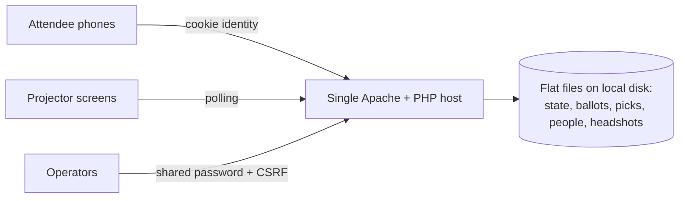

# 01 — Executive Readout

**Subject:** Event Manager — open-source event-night toolkit (repository `robword/s48`)
**Revision assessed:** `4e33d1c` (`main`, last commit 2026-10-22) · **Assessment date:** 2026-10-23
**Prepared for:** CIO, CTO, CISO, IT leadership, Architecture Review Board, business sponsors
**Basis:** Independent static review of the repository only. Nothing was executed, deployed or tested. Supporting detail: [02 Technical assessment](02-technical-architecture-assessment.md) · [03 Risk register](03-risk-register.md) · [04 Adoption roadmap](04-adoption-roadmap.md) · [05 Evidence appendix](05-evidence-and-validation-appendix.md)

---

## Executive summary

**What it is.** Event Manager is a small, self-hosted web toolkit for running an in-person pitch event such as a hackathon or startup weekend. It provides a pitch timer, an opening-night slide deck, **audience voting on attendees' phones** via a QR code, a guided **team-formation** process, a "meet the organizers, judges and mentors" display loop, a judging form, and save/load of the event setup. It was built for the "Startup 48" event and released under the MIT license.

**What problem it could solve.** For innovation days, internal hackathons, accelerator demo nights or sponsored community events, it replaces the mix of paper ballots, spreadsheets and ad-hoc slides with one integrated, brandable tool. No attendee data is sent to third-party services.

**How it is built.** Plain PHP and HTML/JavaScript with no database, no framework and no package dependencies — about 5,200 lines of first-party code. All data is stored as files on a single web server. That makes it cheap to host, easy to understand and easy to take over internally. It also means there is no high availability, no backup, no enterprise identity integration and no audit trail.

**Overall suitability.** The code quality is good for its size, and the security mechanics that exist (password hashing, session and CSRF protection, input validation, safe file handling) are implemented carefully. However, the authors themselves describe it as **"a light-traffic mockup"** with eleven open security gaps. The project is **about five days old**, has **one human maintainer**, **no automated tests and no releases**, and most commits were authored by an AI coding agent. Its main feature, the audience vote, **cannot stop one person from voting many times**.

**Recommendation: PILOT / PROOF OF CONCEPT.** The tool is approved for a controlled pilot at one non-critical event where the audience vote is explicitly **advisory**, behind a rate-limiting reverse proxy and with a manual fallback. It is **not approved** as a production enterprise service until the conditions below are met. It is **not suitable** for binding or high-stakes votes, regulated data, or always-on or highly available services unless significant remediation is done.

**Key qualifications.** These conclusions come from reading the code, not running it. Whether it runs correctly on currently supported PHP versions, how it performs under load, and how well the hosting is protected are all unverified.

---

## Decision at a glance

| | |
|---|---|
| **Primary recommendation** | **PILOT / PROOF OF CONCEPT** |
| **Approved boundary (pilot)** | One in-person event, advisory vote only, tens to low hundreds of attendees, small named organizer team, names and headshots only (no regulated data), hosted on a single hardened host behind a reverse proxy with rate limiting, `data_dir` outside the web root, backups during the event, paper or show-of-hands fallback |
| **Out of bounds** | Binding or consequential votes (prizes, funding, hiring, performance) without voter authentication; always-on or HA services; multiple concurrent events; regulated or sensitive data; deployment without a reverse proxy where the voting page is internet-reachable |
| **Principal benefits** | Integrated event-night workflow; self-hosted with no third-party data processors; zero package dependencies; very cheap to host; MIT license; small and readable enough to own internally |
| **Top five risks** | **R-01 High** — voting identity is a browser cookie, so ballot stuffing is trivial · **R-02 High** — public endpoints can be flooded with files (no rate limiting), which can take the event offline · **R-03 High** — one shared operator password, with no SSO, MFA, roles or audit log · **R-04 High** — days-old project with a single maintainer, no tests and no releases · **R-05 High** — no backup, restore or high availability for live event data |
| **Adoption blockers (production)** | No internal owner for the code (G6); no backup or recovery capability (G5); binding votes without voter authentication (R-01); internet exposure without rate limiting (R-02); unverified compatibility with supported PHP versions (U-01) |
| **Required next steps** | 1) Sponsor decides whether the vote is advisory or binding · 2) Legal review of license, branding carve-outs and AI-authored code · 3) Assign an internal owner and fork the code · 4) Stand up the pilot host behind a proxy with rate limits, backups and a protected `data_dir` · 5) Run a full dress rehearsal and load test before the pilot event |

---

## Architecture overview

A single Apache + PHP web server hosts every component. Attendees' phones load a voting page and post ballots or team picks to small JSON endpoints, identified only by a random cookie. Projector screens poll public endpoints every few seconds for the voting QR code, live team counts and the showcase loop. Organizers use one password-protected console to control the evening: start and close voting, see the live ranking, choose advancing ideas, run team-formation phases and download rosters. All state is JSON files on local disk, written atomically and serialized with file locks. This design is correct for one server and cannot be spread across several. There is no database, no background processing and no outbound calls to third parties. An optional GitHub Actions workflow deploys by rsync over a restricted SSH key and verifies the result.

**Major dependencies:** a PHP runtime (8.1+ declared), Apache with `.htaccess` support (which carries the storage protection and HTTPS redirect), a local POSIX filesystem, and one vendored QR-code library.

---

## Domain assessment summary

| Domain | Rating | Confidence | Principal concern | Recommended action |
|---|---|---|---|---|
| A. Security & privacy | CONDITIONAL | Medium | No voter authentication or abuse protection; shared operator password; no audit | Advisory-only use; reverse proxy with SSO + MFA on operator paths and rate limits on public paths (W-06, W-09) |
| B. Architecture & engineering quality | CONDITIONAL | Medium | No automated tests; single-node design cannot scale out or fail over | Load and concurrency test before use; accept single-node limits (W-15) |
| C. Enterprise integration | WEAK | High | No SSO, API specification, webhooks or results export | Treat as a standalone tool; SSO via proxy; optional results export (W-06, W-19) |
| D. Licensing, legal & compliance | ADEQUATE | Medium | MIT is clear, but Startup 48 branding and content are reserved; AI-authorship ownership question | Legal review and rebranding (W-01, W-07) |
| E. Deployment, operations & reliability | WEAK | High | No backup, monitoring, HA or DR | Event-time backups, monitoring, runbook, manual fallback (W-11, W-13, W-17) |
| F. Sustainability & governance | WEAK | High for repo facts / Low for upstream future | Single maintainer, days old, no releases or security policy | Fork and own internally; the code is small enough to do so cheaply (W-04, W-20) |
| G. Total cost of ownership | CONDITIONAL | Medium | Low for advisory use; rises sharply if votes are binding or audit is required | Choose the scenario explicitly (W-02) |
| H. Functional fit | CONDITIONAL | Medium | Strong for its niche; narrow scope; no requirements provided | Confirm the use case; run the pilot (W-02, Stage 1) |

---

## Adoption-gate results

| Gate | Disposition | Outstanding conditions |
|---|---|---|
| 1. Security posture & vulnerability management | CONDITIONAL | Rate limiting, file caps, SAST and front-end sink review, HSTS; internal ownership of patching |
| 2. Authentication, authorization & identity | CONDITIONAL (FAIL where policy forbids shared credentials without SSO) | SSO + MFA reverse proxy on operator paths; per-event password rotation |
| 3. Licensing & legal | CONDITIONAL | Legal sign-off; replace Startup 48 branding, judging form and deck content |
| 4. Data protection & privacy | CONDITIONAL | Privacy screening; notice on the voting page; retention and purge procedure; `data_dir` outside the web root |
| 5. Operational supportability & recovery | CONDITIONAL for pilot; FAIL for business-critical or HA use | Backups during events, restore drill, monitoring, runbook, manual fallback |
| 6. Sustainable maintenance & upgrade path | FAIL as an external dependency; CONDITIONAL if internally owned | Internal fork with a named owner; patch and upstream-review cadence |
| 7. Architectural compatibility & integration | CONDITIONAL | Hosting decision (Apache or equivalent rules); accept that there is no HA |
| 8. Functional suitability | UNVERIFIED | Confirm use case and audience size; pilot event |

These gate results are consistent with a pilot, not with production approval.

---

## Enterprise suitability scenarios

| Scenario | Suitability | Why |
|---|---|---|
| **Internal, non-critical event tool** (e.g., an advisory "people's choice" vote at an internal hackathon) | **Suitable for pilot; adoptable with conditions after it** | Risks are tolerable if the vote is advisory, operators are few and named, and basic controls (proxy, backups, fallback) are in place. Note that attendees usually vote from personal phones over the internet, so even an "internal" event is effectively internet-facing. |
| **Business-critical internal service** | **Not suitable as-is** | No HA, no backups, no audit, single maintainer. Would need internal ownership plus operational controls, and still could not be made highly available without redesign. |
| **Internet-facing application** (public or community event) | **Conditional** | Acceptable only behind a WAF or rate-limiting proxy, with rebranding, a privacy notice and an advisory vote. Without rate limiting, one script can disrupt the event (R-02). |
| **Sensitive or regulated data** | **Not suitable** | No encryption, retention, subject-request or audit capabilities. The application should hold only names, employers and headshots that participants expect to be shown publicly. |
| **Large-scale or high-availability deployment** | **Not suitable** | The single-node file-based design cannot be load-balanced or made redundant. Capacity beyond a few hundred honest voters is unverified. |

---

## Strategic and economic considerations

- **Benefits:** one integrated, polished event-night experience; organizational data stays on infrastructure the organization controls; no license fees; tiny hosting footprint; the code is easy to fork, rebrand and extend.
- **Major TCO drivers:** security compensating controls (proxy, SSO, rate limiting); per-event operations (rehearsal, monitoring, backups, purge); internal ownership of the fork (PHP runtime updates, upstream review); rebranding; and voter authentication if votes become binding, which is the largest single development item.
- **Build vs. buy:** commercial live-polling or hackathon-management services usually offer authenticated voting, SSO, audit trails and vendor-run availability, in exchange for subscription fees and third-party data processing. They are the better choice when votes are binding, events are frequent or large, or PHP and hosting skills are not available in-house. This tool is the better choice for occasional, advisory, self-hosted use.
- **Support burden:** low in steady state, concentrated around each event (rehearsal, on-site operator, post-event purge). No vendor support exists.
- **Sustainability risks:** upstream may stop or change direction at any time; there is no release or security-advisory process. The mitigation is internal ownership of a reviewed fork.
- **Exit strategy:** straightforward. Data is plain JSON, and the event file and roster CSV are portable. Lock-in is negligible.

---

## Decision and conditions

**Recommended disposition: PILOT / PROOF OF CONCEPT.**

**Conditions before the pilot event:**
1. The business sponsor records that the audience vote is **advisory** (R-01 accepted for the pilot).
2. The host is a single hardened server: supported PHP version, `data_dir` outside the web root, `public_base_url` set, protected paths verified to return 403/404 (W-03).
3. A reverse proxy or WAF rate-limits the voting endpoints (W-09) and, where policy requires it, enforces SSO + MFA on operator paths (W-06).
4. `data_dir` is copied to separate storage during the event, and a manual voting fallback is prepared (W-11, W-17).
5. Startup 48 branding and reserved content are replaced or written permission is obtained (W-07), following legal guidance (W-01).
6. A full dress rehearsal is completed, including phones on cellular data (W-17c).

**Additional conditions before production (recurring use):** a named internal owner and fork (W-04); a load test at twice the expected audience (W-15); a restore drill (W-17a); SIEM logging and monitoring (W-13); a privacy notice and retention procedure (W-14); a security review of all front-end code (W-05b); ARB approval of residual risks.

**Risks requiring explicit acceptance:** R-01 (advisory vote integrity), R-03 residual (all operators have equal power), R-13 (no HA), R-16 (minor concurrency races).

**Questions requiring external validation:** runtime compatibility (U-01), effectiveness of storage protection and tenant isolation (U-02, U-07), concurrency at scale (U-03), ownership of AI-authored code (U-08), front-end XSS coverage (U-09), accessibility (U-10), upstream health (U-11), personal data in scope (U-12).

**Circumstances that would change the recommendation:**
- → **ADOPT WITH CONDITIONS** after a successful pilot, with internal ownership, the production conditions above, and votes remaining advisory.
- → **DO NOT ADOPT** if votes must be binding and no budget exists for voter authentication; if HA is required; if regulated data is in scope; or if organizational policy prohibits unreviewed AI-generated code or shared credentials without compensating SSO.
- → **DEFER** if no internal owner or reverse-proxy capability can be provided.

---

## Architecture Review Board decision record (proposed)

| Field | Entry |
|---|---|
| **Decision requested** | Approve Event Manager (revision `4e33d1c`, or a reviewed internal fork of it) for a controlled pilot |
| **Scope** | One in-person event; advisory audience vote; team formation; showcase loop; timer and slides; single host; tens to low hundreds of attendees; personal data limited to names, employers, titles, skills and headshots intended for public display, and participant first names |
| **Decision** | **PILOT / PROOF OF CONCEPT** — approved under the conditions above; production use not yet approved |
| **Rationale** | Strong functional fit for a narrow need; careful implementation of the controls that exist; no third-party data flows; low cost; easy to own internally. Offset by missing identity, abuse-protection, audit, backup and HA capabilities, and by a days-old, single-maintainer upstream with no tests or releases. These gaps can be mitigated for an advisory, time-boxed pilot, but are not yet mitigated for production. |
| **Conditions** | Pilot conditions 1–6; production conditions as listed above (roadmap Stages 2–3) |
| **Known limitations** | Cookie-based voter identity; single shared operator credential; single node with no HA; no backups or audit log in the app; Apache-specific protections; English only; no results export; reserved third-party branding |
| **Unresolved issues** | U-01 to U-12 (see risk register and appendix) |
| **Accountable roles** | *Business sponsor* — use-case and vote-criticality decision, acceptance of R-01 · *Enterprise architect* — ARB submission and conditions tracking · *Application owner* — fork, configuration, rebranding, retention · *Platform engineer* — host, proxy, backups, monitoring · *IAM engineer* — SSO proxy policy · *Security engineer* — code review, rate limits, hardening · *Privacy officer* — screening, notice, retention · *Legal counsel* — license and branding review · *Event operations lead* — runbook, rehearsal, fallback |
| **Review point** | After the pilot event: post-event review against roadmap Stage 3 criteria, then ARB decision on ADOPT WITH CONDITIONS, extended pilot, or DO NOT ADOPT |
