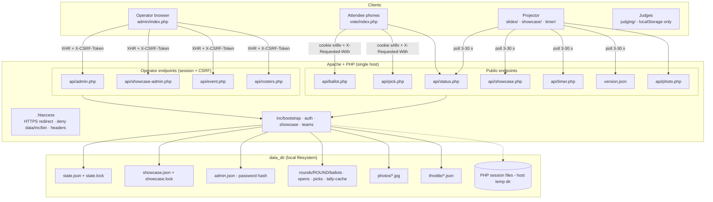
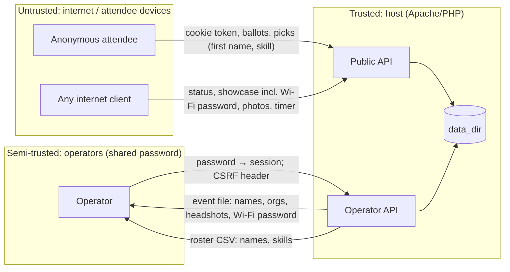
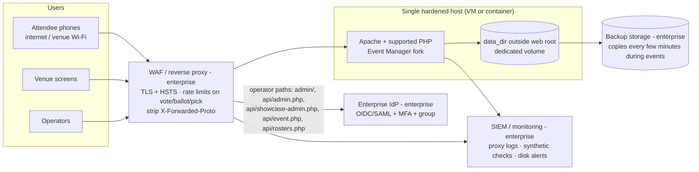

# 02 — Technical Architecture Assessment

**Subject:** Event Manager (`robword/s48`)
**Revision:** `4e33d1c0944f0d278288167aad981e29c9be1c07` (`main`, last commit 2026-10-22)
**Audience:** Enterprise, solution and security architects; engineering leaders; infrastructure teams
**Related:** [01 Executive readout](01-executive-readout.md) · [03 Risk register](03-risk-register.md) · [04 Adoption roadmap](04-adoption-roadmap.md) · [05 Evidence appendix](05-evidence-and-validation-appendix.md)

Citations use `path:Lstart-Lend` (paths relative to the repo root; `event-manager/` abbreviated as `em/` in dense tables) and evidence IDs `EV-nn` from doc 05.

---

## 1. Scope, methodology, assumptions and limitations

**Method.** Static, read-only inspection of every tracked file (52 files): all PHP, all HTML/JS pages, `.htaccess` files, CI/CD workflows, docs, licenses and git history. Security-critical paths (authentication, session, CSRF, voter identity, file writes, uploads, public endpoints, deploy pipeline) were read line by line. Front-end output sinks were sampled by searching for `innerHTML`, `textContent` and string-built markup. Nothing was executed, built, installed, deployed or tested.

**Assumptions (provisional).**
- A1. The adopter would deploy this for **in-person events** where attendees use **personal phones**, typically over the public internet (the README tells operators to rehearse "from a phone on cellular data", `em/README.md:L189`). The voting surface is therefore usually internet-facing even for "internal" events.
- A2. The adopter has, or can obtain, a reverse proxy/WAF and an enterprise IdP. Where it cannot, compensating controls are weaker and this is called out.
- A3. No regulated data categories (health, payment, government ID) will be entered. Names, employers, headshots and first names are expected.
- A4. Audience size is tens to low hundreds of people per event (consistent with the README's design note, `em/README.md:L171`).

**Limitations.** See doc 05 §H. In short: no runtime evidence, no performance data, no vulnerability scanning, no visibility of GitHub or hosting configuration, five days of history.

---

## 2. Repository inventory and analyzed revision

| Area | Contents | Notes |
|---|---|---|
| Root | `README.md`, `LICENSE` (MIT), `NOTICE.md`, `CONTRIBUTING.md` | No `SECURITY.md`, CHANGELOG, CODE_OF_CONDUCT, GOVERNANCE |
| `.github/` | `workflows/ci.yml`, `workflows/deploy.yml`, `dependabot.yml` | No issue/PR templates, no CODEOWNERS |
| `event-manager/inc/` | `bootstrap.php` (storage, state, voters, HTTP helpers), `auth.php`, `showcase.php`, `teams.php`, `config.sample.php`, `.htaccess` | Core server logic, ~900 lines |
| `event-manager/api/` | 10 JSON/CSV/JPEG endpoints | ~660 lines |
| `event-manager/{admin,vote}/` | PHP pages with inline JS | Operator console (996 lines), voting page (377 lines) |
| `event-manager/{slides,showcase,timer,judging}/`, `index.html` | Static HTML with inline JS | ~1,800 lines |
| `event-manager/assets/` | `common.js`, `theme.css`, vendored `qrcode.js`, fonts + licenses, logo SVGs | |
| `event-manager/bin/` | `set-password.php`, `dev-router.php` | CLI-only |

**Version identifiers:** none besides the git SHA (EV-34). The deploy job stamps `version.json` with the short SHA (`.github/workflows/deploy.yml:L55-L60`).

---

## 3. Product overview and use cases

**What it is (VERIFIED, EV-01).** A toolkit for running the opening night and weekend of a Startup-Weekend-style event:

| Capability | Status | Evidence |
|---|---|---|
| Pitch timer with configurable warning/danger tones, presets, deep links, keyboard control, audio fallbacks | Implemented | `em/timer/index.html`; `em/inc/showcase.php:L16-L20`, `L57-L78` |
| Opening-night slide deck with live voting QR slide and "Form your team" slide | Implemented; deck content is Startup 48-specific placeholder/schedule | `em/slides/index.html`; `NOTICE.md:L17-L19` |
| Audience voting on phones (up to 3 votes per device, editable until close), live ranking for operator | Implemented | `em/api/ballot.php`; `em/inc/bootstrap.php:L252-L334` |
| Team selection: advancing ideas → stations → phased Explore/Choose/Finalize/Set → phone picks with first name and skill → organizer rebalancing → CSV rosters | Implemented | `em/inc/teams.php`; `em/api/pick.php`; `em/api/admin.php:L128-L189` |
| Showcase loop: organizers/judges/mentors with headshots, Wi-Fi info, schedule countdown, announcement | Implemented | `em/showcase/index.html`; `em/inc/showcase.php` |
| Judging form (browser-local notes, print to PDF) | Implemented; content is reserved Startup 48 material | `em/judging/index.html`; `NOTICE.md:L17` |
| Event setup save/load as one JSON file | Implemented | `em/api/event.php` |
| Per-user operator accounts, audit log, rate limiting, backups, multi-event | **Not implemented** (acknowledged gaps) | `em/README.md:L219-L245` |
| Judge score aggregation, results export, multi-event history | **Not observed** | EV-38, EV-39 |

**Intended users:** event organizers/operators (console), attendees (phones), presenters/judges (timer, judging form), venue screens (slides, showcase).

**Plausible enterprise use cases:** internal hackathons, innovation days, pitch competitions, accelerator demo nights, community/university events sponsored by the organization.

---

## 4. Technology stack

| Layer | Technology | Evidence | Lifecycle note |
|---|---|---|---|
| Server language | PHP ≥ 8.1, strict types, procedural functions prefixed `s48_` | EV-02 | 8.1 is beyond upstream security support (external fact, not in repo); supported-version compatibility UNVERIFIED (R-15) |
| Web server | Apache httpd + `mod_rewrite`, `mod_headers`, `AllowOverride All` | `em/.htaccess` | Security rules are Apache-specific (R-07) |
| Persistence | JSON files and empty marker files on the local filesystem | EV-03 | No database, no migrations |
| Sessions | PHP native sessions (default file handler) | `em/inc/auth.php:L10-L25` | Single node |
| Client | ES5 / ES2017 JavaScript, inline in pages; XHR and `fetch`; no framework | `em/assets/common.js` | No build, no transpile; broad browser support targeted |
| Vendored library | `qrcode.js` (Kazuhiko Arase, MIT) | EV-32 | Version undocumented in file |
| CI/CD | GitHub Actions (lint, deploy via rsync/SSH with `rrsync`) | EV-27, EV-28 | SHA-pinned action; Dependabot for actions |
| Containers / IaC / orchestration | **None** | EV-35 | — |

The stack is deliberately minimal (`CONTRIBUTING.md:L7-L9`: "No database, no build step, no CDN"). For enterprise ownership this is a double-edged choice: almost no supply-chain surface and trivial deployability, but no framework-provided security, testing or scaling capabilities.

---

## 5. Architecture reconstruction (current state)

### 5.1 Architectural style

A **single-node, page-per-feature PHP application with a JSON RPC-style API and polling clients**. Server code is a small procedural library (`inc/`) shared by thin endpoint scripts (`api/`). All UI is server-delivered static HTML (or PHP pages that render a shell) with inline JavaScript calling the API. There is no routing layer, DI container, ORM or template engine; each file is an entry point. State lives in files under `data_dir`.

### 5.2 Component diagram (observed)

### 5.3 Request and processing lifecycles

**Voting (attendee).**
1. Phone scans QR → `GET vote/` → server issues `s48v` cookie if absent and touches `opens/<sha256(token)>` (`em/vote/index.php:L11-L17`; `em/inc/bootstrap.php:L219-L246`).
2. Page polls `api/status.php` and reads its own ballot via `GET api/ballot.php`.
3. Submit → `POST api/ballot.php` with `X-Requested-With: s48` → validate status `open`, integer counts, known pitch IDs, total 1–3 → atomic write of `ballots/<sha256(token)>.json` (`em/api/ballot.php:L21-L62`).

**Tally.** `s48_round_counts` scans `opens/` and `ballots/`, sums votes, caches for ~2 s (`em/inc/bootstrap.php:L252-L297`); `s48_results` ranks by votes, then distinct voters, then pitch order (`L299-L334`).

**Operator control.** `POST api/admin.php {action}` → `s48_require_admin_api()` (session + CSRF) → `s48_update_state()` takes `flock(LOCK_EX)` on `state.lock`, mutates, atomically writes `state.json` (`em/inc/bootstrap.php:L139-L156`; `em/api/admin.php:L37-L207`). The state machine is: `setup → open ⇄ closed → teams(explore → choose → finalize → set)`, with guarded back-steps and `reset` (new round ID; old round directories retained).

**Team picks.** `POST api/pick.php` during Choose/Finalize writes `picks/<sha256(token)>.json`; operator `pick_move` rewrites or deletes that file (`em/api/pick.php:L8-L50`; `em/api/admin.php:L163-L181`).

**Showcase and photos.** Operator uploads a browser-cropped JPEG as a data URL; server validates, re-encodes with GD if present, stores `photos/<random32hex>.jpg`, served by `api/photo.php` (EV-18).

**Event file.** Export embeds headshots as base64; import stages photos one request at a time, then replaces state and showcase (two locks) and sweeps unreferenced photos older than 10 minutes (`em/api/event.php:L62-L79`, `L122-L144`).

### 5.4 State, caching and background work

- No background workers, cron jobs or queues. All "live" behaviour is client polling (EV-45).
- The only server cache is `tally-cache.json` (2 s). Static assets use `Cache-Control: no-cache` for revalidation; headshots are `immutable` for 7 days.
- Client state: `localStorage` for timer preferences, console section collapse, attendee first name, and judging notes.

### 5.5 Error handling and configuration

- Domain errors (`S48Error`) map to HTTP status + message; other throwables are logged with `error_log` and returned as a generic 500 (`em/inc/bootstrap.php:L377-L387`). This avoids leaking stack traces (good).
- Configuration is a PHP array file (`inc/config.php`, git-ignored) merged over defaults (`L30-L55`). Secrets: the operator password hash lives in `data/admin.json` or in config. No environment-variable support, no external secrets manager integration.

### 5.6 Critical runtime dependencies and single points of failure

The host, its filesystem, Apache rule processing and the PHP runtime are each a single point of failure. The operator's laptop is also a soft SPOF (one shared login; a second operator can log in, which mitigates).

---

## 6. Components and dependencies

| Component | Responsibility | Key files | Coupling notes |
|---|---|---|---|
| Storage & state core | Atomic writes, locking, state machine persistence, round dirs, tally | `em/inc/bootstrap.php` | Every endpoint depends on it; filesystem semantics are assumed |
| Auth | Operator session, CSRF, throttle | `em/inc/auth.php` | Used by operator endpoints and `admin/index.php` |
| Showcase | People, event info, timer settings, photos | `em/inc/showcase.php` | Event info also drives team sizing and timer tones (cross-feature coupling via one JSON document) |
| Teams | Picks, team board, CSV | `em/inc/teams.php` | Reads state and showcase |
| Operator console | Single-page UI for the entire night | `em/admin/index.php` (≈1,000 lines inline JS/CSS/HTML) | Largest and most change-prone file |
| Voting page | Ballot and team-pick UI | `em/vote/index.php` | Shares device token with picks |
| Display pages | Slides, showcase loop, timer | `em/slides/`, `em/showcase/`, `em/timer/` | Showcase scrapes the schedule from the slides HTML (`em/showcase/index.html:L283-L289`) — content coupling |
| CI/CD | Lint and deploy | `.github/workflows/*` | Host-specific (rrsync) |

External dependencies are listed in doc 05 §C. **No runtime calls to third-party services were found.**

---

## 7. Data flows and trust boundaries

| Boundary | Crossing data | Control | Assessment |
|---|---|---|---|
| Internet → public API | Ballots, picks, page loads | Input validation; body size caps; custom header vs. CSRF; **no authentication, no rate limit** | Validation strong; identity and abuse controls absent (R-01, R-02) |
| Internet → public read API | Showcase data incl. Wi-Fi password; counts; timer settings; photos | None (public by design) | Acceptable only if all showcase content is meant to be public (R-08, R-21) |
| Operator → operator API | All control actions, personal data export | Password session + CSRF + SameSite=Strict | Sound mechanics; single shared credential (R-03) |
| Web tier → `data_dir` | Everything at rest | `.htaccess` deny or path outside web root | Depends on configuration (R-07) |
| Host → other tenants (shared hosting) | Files in `data_dir` | Host permissions; dirs created 0775 | UNKNOWN (U-07) |
| CI → host | Code | SSH key restricted by `rrsync`, pinned host key, environment secrets | Good design; settings UNVERIFIED (U-06) |

**Data categories (INFERRED from code):** operator password hash; device tokens (hashed on disk); votes; participant first names and self-declared skill; organizer/judge/mentor names, employers, titles, skills, availability, first-attendance year and **headshots**; Wi-Fi credentials; announcement text. No email addresses, phone numbers or IP addresses are stored by the app (throttle files are keyed by a SHA-256 of the IP — a pseudonymous identifier — `em/inc/auth.php:L56-L59`). Web-server access logs (outside the app) will contain IPs.

---

## 8. Security and privacy assessment

### 8.1 Identity and access management

| Aspect | Observed | Evidence | Assessment |
|---|---|---|---|
| Operator authentication | One password, bcrypt (`PASSWORD_DEFAULT`), set via CLI or config | EV-06, EV-07 | Mechanically sound; not enterprise identity |
| Authorization | Binary: operator or not; all operator endpoints call `s48_require_admin_api()` | `em/inc/auth.php:L105-L114`; every operator endpoint's first line | **Consistently enforced** in all four operator APIs and `admin/` (VERIFIED by reading each) |
| Roles / least privilege | None | — | All operators can reset votes and export personal data |
| Session management | `HttpOnly`, `SameSite=Strict`, `Secure` when HTTPS detected, strict mode, regenerate on login and logout; browser-session lifetime; idle expiry = PHP GC defaults | `em/inc/auth.php:L10-L25`, `L91`, `L97-L102` | Good; no explicit idle/absolute timeout |
| CSRF | Per-session token, constant-time check, header for XHR, hidden field for forms | `em/inc/auth.php:L42-L54`; `em/admin/index.php:L12-L28` | Good |
| Brute force | 5 failures / 10 min per `REMOTE_ADDR` + 300 ms delay | `em/inc/auth.php:L56-L95` | Weak behind proxies (shared IP lockout) and against distributed guessing |
| SSO / OIDC / SAML / LDAP / SCIM | Not supported | — | Achievable via reverse-proxy enforcement on path prefixes (operator paths are distinct files) |
| Service accounts / machine access | None (no API tokens) | — | Integration via API requires the browser session flow |
| Voter identity | Self-issued random cookie; hashed for storage | EV-09 | Privacy-friendly, **not** an integrity control (R-01) |
| Credential rotation | Re-run `set-password.php`; sessions are not invalidated on rotation | EV-07 | Existing sessions persist until expiry after a password change (INFERRED from code: no session store purge) |

### 8.2 Application security

| Concern | Observed | Evidence | Assessment |
|---|---|---|---|
| Input validation | Strong and centralized: control-char stripping, length caps, integer/enum checks, regex-validated IDs, strict JSON | `em/inc/bootstrap.php:L201-L209`; `em/inc/showcase.php:L121-L198`; `em/api/ballot.php:L32-L58` | Strength |
| Injection (SQL/command) | No SQL; no shell calls except `stty` in CLI script | `em/bin/set-password.php:L14-L22` | Not applicable / negligible |
| Path traversal | All filenames are server-generated hashes or regex-checked hex IDs; round ID regex-checked | `em/inc/bootstrap.php:L158-L165`; `em/api/photo.php:L7-L8`; `em/inc/teams.php:L38-L44` | Strength |
| XSS | Server: `htmlspecialchars` helper and `json_encode` into script; client: `textContent`/DOM APIs; the few `innerHTML` writes sampled use constants, numbers, or sanitized initials; attacker-controlled strings are not interpolated into HTML in sampled code | EV-21; `em/admin/index.php:L408`; `em/slides/index.html:L388` | Good in sample; **full coverage unverified (U-09)**; no CSP as backstop (R-09) |
| `json_encode` into `<script>` | `S48.csrf = <?= json_encode($csrf) ?>` — value is hex, so safe | `em/admin/index.php:L408` | OK |
| CSV/formula injection | Guarded with leading-apostrophe for `= + - @` | `em/inc/teams.php:L101-L104` | Strength (tab/CR prefixes not covered — Low) |
| File upload | JPEG-only data URL, magic bytes, size and dimension limits, GD re-encode, random name, served `image/jpeg` + `nosniff` | EV-18 | Strength; without GD the original bytes (and metadata) are stored |
| Deserialization | `json_decode` only; no `unserialize` | grep | OK |
| SSRF | No server-side outbound requests | — | Not applicable |
| Error exposure | Generic 500; domain messages only | EV-22 | Good |
| Security headers | `nosniff`, `X-Frame-Options: DENY`, `Referrer-Policy`; **no CSP, no HSTS** | EV-48 | Gap (R-09) |
| Host-header / proxy-header trust | `X-Forwarded-Proto` trusted from any client; Host fallback for vote URL | EV-23 | Low risk if `public_base_url` is set (R-10) |
| Concurrency/TOCTOU | Ballot/pick writes not serialized with status changes | EV-42 | Low (R-16) |
| Sensitive logging | Only exceptions are logged; no passwords or tokens logged | EV-22 | Good |

**Notable judgment:** for its size, the code shows deliberate, consistent secure-coding practice (centralized validation, atomic writes, CSRF, careful output encoding, formula-injection guard, metadata stripping). The weaknesses are *missing controls by design* — identity, abuse protection, audit — rather than sloppy implementation. No confirmed exploitable vulnerability was found in the inspected paths.

### 8.3 Infrastructure security

- **Transport:** HTTPS enforced by `.htaccess` redirect (`em/.htaccess:L14-L15`); cookies `Secure` only when HTTPS is detected. No HSTS. TLS itself is a host concern.
- **Exposure:** All pages and APIs share one origin; operator and public endpoints are distinct files, which makes path-based proxy controls feasible.
- **At-rest encryption:** None in the app; depends on host disk encryption.
- **Isolation of storage:** default `data_dir` inside web root protected by `.htaccess` and an auto-written deny file (`em/inc/bootstrap.php:L67-L75`); README recommends moving it outside (R-07). `Options -Indexes` set.
- **Privileges:** runs as the web-server/PHP user; no root or special capabilities. Directories created `0775` (group-writable).
- **Containers / segmentation:** none provided; the app is compatible with standard reverse-proxy and network segmentation patterns since it makes no outbound calls.

### 8.4 Software supply chain

| Aspect | Observed | Assessment |
|---|---|---|
| Dependencies | Zero package dependencies; one vendored JS library | Very small attack surface (strength) |
| Pinning / lockfiles | Not applicable for app; GitHub Action pinned by SHA | Strength |
| Update mechanism | Dependabot for Actions only; vendored lib manual | `qrcode.js` provenance/version unverified (R-19) |
| Build reproducibility | No build; deploy copies files and adds `version.json` | Effectively reproducible from a SHA |
| Artifact signing / SBOM / provenance | None | Acceptable for this scale; note for policy |
| CI security | `permissions: contents: read`; secret grep for 3 patterns; no SAST, no dependency/secret scanner | Partial (R-06, R-19) |
| Deploy security | Manual dispatch, `production` environment, mandatory pinned host key, rrsync-restricted key, marker-file guard, post-deploy checks | Thoughtful design (strength); repo settings unverified, and the referenced "setup script" is absent (EV-46) |
| Contributor provenance | DCO required by policy but not used; 40/41 commits by an AI-agent identity | Governance inconsistency (R-12) |

### 8.5 Data security and privacy

| Control | Observed | Evidence |
|---|---|---|
| Data minimization | Ballots hold only votes + timestamp; device tokens stored hashed; participant picks hold first name + skill | EV-11, EV-14 |
| Public exposure | Showcase (names, orgs, titles, skills, headshots, Wi-Fi password) and participation counts are public by design | EV-16, EV-17 |
| Retention / deletion | Individual people can be deleted (photo file removed); **rounds are never deleted**; no purge tooling | EV-37 |
| Export / portability | Event file (setup data incl. headshots); roster CSV; no results export; no per-person data-subject export | EV-19, EV-20, EV-39 |
| Encryption | None at application level | — |
| Audit of data access | None in app | R-14 |
| Telemetry / third parties | None observed | doc 05 §C |
| Notice / consent | No privacy notice on voting page | EV-47 |
| Residency | Wherever the host is; no external processors | — |
| Backup exposure | Event-file export contains headshots and Wi-Fi password; handled as a downloaded file | `em/README.md:L115-L116` |

The application **supports** a privacy-respectful deployment (little data, no third parties, hashed tokens) but provides no **controls** for retention, notice, or subject requests. Compliance with any privacy law is the adopter's responsibility and cannot be inferred from the code.

### 8.6 Security conclusion

- **Strengths:** consistent server-side validation; correct CSRF and session hardening; safe file handling; minimal supply chain; no outbound data flows; careful deploy pipeline; candid documentation of gaps.
- **Material gaps:** no voter authentication (R-01); no abuse protection on public writes (R-02); shared operator credential, no SSO/MFA/audit (R-03); Apache-dependent storage protection (R-07); no CSP/HSTS (R-09).
- **Controls required outside the application:** reverse proxy with SSO+MFA on operator paths, rate limiting/WAF, `data_dir` outside web root on a monitored volume, HSTS, log forwarding, backups.
- **Potential adoption blockers:** binding votes without W-08; internet exposure without rate limiting; policies forbidding shared credentials without SSO compensation.
- **Questions requiring validation:** U-01, U-02, U-07, U-09.

---

## 9. Engineering quality and scalability assessment

**Current implementation.** Small, coherent, idiomatic procedural PHP with strict types and consistent naming (`s48_*`), clear docblocks explaining *why*, and a single concurrency discipline applied everywhere (one file per writer; operator writes under an exclusive lock; temp-file + rename). Front-end pages are self-contained with inline JS (ES5 for broad device support).

| Dimension | Observation | Evidence | Implication |
|---|---|---|---|
| Modularity | `inc/` holds reusable logic; endpoints are thin | §6 | Easy to read and fork |
| Complexity hot spot | `admin/index.php` is ~1,000 lines of mixed PHP/HTML/CSS/JS | file size | Highest maintenance cost; changes risk regressions |
| Testing | **No automated tests** of any kind; CI = `php -l` | EV-27, EV-35 | Regressions undetected (R-06) |
| Load claim | 60 concurrent voters "tested locally" — no artifact | EV-26 | UNVERIFIED |
| Concurrency | Sound for POSIX local FS; TOCTOU between status read and ballot write; organizer/phone pick race | EV-42, EV-15 | Low impact (R-16) |
| Scalability | Tally is O(files) per 2-s window; directory scans grow with abuse; `glob()` for picks each board render | EV-12; `em/inc/teams.php:L22-L36` | Adequate for hundreds of honest users; degrades under abuse (R-02) |
| Horizontal scaling | Not possible without shared storage + shared sessions; `flock` over NFS is unreliable (INFERRED) | EV-43 | Single node only (R-13) |
| Vertical scaling | Limited by disk I/O and PHP workers; no tuning documentation | — | Size host generously for event bursts |
| Data migration | No schema versioning except event-file `version: 1`; defaults merged via `array_replace_recursive` for showcase data, which tolerates added fields | `em/inc/showcase.php:L85-L89` | Upgrades are forgiving for additive changes; no migration framework |
| Upgrade compatibility | Deploy excludes `data/` and `config.php`; no data-format change log | EV-28 | Upgrades are file swaps; review diffs for data-shape changes |
| Portability | Any Apache+PHP host; non-Apache requires re-implementing rules | EV-05 | Containerization is straightforward but not provided |
| Resilience | No retries server-side; clients poll and keep last good data (showcase) | `em/showcase/index.html:L280-L282` | Display clients degrade gracefully; voting fails hard on storage errors |
| Technical debt indicators | Code duplication between `s48_clean_name` and `s48_clean_text`; constants duplicated between PHP and timer JS ("Keep in step with PRESETS", `em/inc/showcase.php:L14-L15`); showcase scrapes slide HTML | code | Minor; manageable in a fork |

**Engineering investment likely before enterprise use:** an end-to-end smoke test and concurrency test (W-05/W-15), file caps (W-10), optional voter-identity change (W-08), rebranding (W-07). Each is Small–Medium given the codebase size.

---

## 10. Enterprise integration assessment

| Integration need | Classification | Notes |
|---|---|---|
| SSO for operators | **Standards-based via proxy** (custom-development feasible natively) | Path-separated operator endpoints allow OIDC/SAML enforcement at a reverse proxy; app still requires its own password |
| SSO for voters | **Custom development feasible** | Replace cookie token with proxy-asserted identity (W-08); contained change per README |
| SCIM / directory sync | **Architecturally not applicable** | No user store to provision |
| Logging / SIEM | **Standards-based via web server** | App logs only exceptions; use Apache/proxy logs |
| Monitoring | **Custom (synthetic)** | `api/status.php` and `version.json` usable as health probes |
| Secrets management | **Constrained** | Hash in a file or PHP config; no env-var or vault support; can be templated by config management |
| Backup tooling | **Standards-based (file-level)** | Copy `data_dir`; consistent snapshot needs the state lock or a quiet moment |
| Data / analytics | **Constrained** | Roster CSV only; no results export (EV-39); ballot JSON files are readable by scripts |
| Webhooks / events / queues | **Not observed** | — |
| API for automation | **Unverified / unstable** | Internal JSON RPC, undocumented, unversioned; operator API needs browser session + CSRF |
| ITSM | **Not applicable** | — |

**Lock-in:** negligible. Data is plain JSON files; the event file and CSV are portable. **Integration maintenance burden:** low, because there is little integration. The real cost is that any enterprise integration means custom code in a fork.

---

## 11. Licensing and compliance assessment

**Licensing (technical observations; not legal advice).**
- Code: MIT (`LICENSE`). Permissive, no copyleft or network-use obligations; redistribution requires keeping the notice.
- Reserved content: Startup 48 name, logo, wordmark, brand look, judging form and deck text are **not** MIT (`NOTICE.md:L7-L21`) and are wired into the UI and defaults (EV-36). Any adopter must replace them.
- Fonts: OFL 1.1 (Poppins, Raleway) and Ubuntu Font Licence 1.0, license texts shipped; files are subsets converted to WOFF2 — subset/rename obligations need confirmation.
- `qrcode.js`: MIT; DENSO WAVE trademark on "QR Code".
- **Inconsistencies:** DCO required but unused (EV-33, EV-34); version claim for `qrcode.js` unverifiable (EV-32).
- **Requires legal review:** AI-authored contributions and copyright ownership (U-08); branding removal; font modification clauses.

**Compliance relevance (only frameworks plausibly touched).**

| Framework | Relevant? | Built into app | Must be provided by adopter | Cannot assess |
|---|---|---|---|---|
| GDPR / similar privacy laws | Yes — names, employers, headshots, first names | Data minimization, hashed tokens, per-person delete, no third parties | Privacy notice, legal basis, retention/purge, subject requests, DPIA if needed, processor terms with host | Lawfulness of any specific deployment |
| SOC 2 / ISO 27001 (if the tool is in an audited scope) | Possibly | CSRF, session hardening, password hashing | Named access, MFA, access logging, change management, backups, vulnerability management | Operating effectiveness |
| NIST CSF | As a lens | Protect: some; Detect/Respond/Recover: minimal | Monitoring, incident response, recovery | — |
| Accessibility (e.g., WCAG-based obligations) | Yes for attendee-facing voting | `lang` attributes, some ARIA, large touch targets (44 px buttons) | Formal audit and remediation | Conformance level (U-10) |
| HIPAA / PCI DSS | Not applicable under assumption A3 | — | Do not use for such data | — |
| Records retention | Possibly, if votes decide prizes/funding | Old rounds retained (unbounded) | Policy-based retention and export | — |

---

## 12. Deployment and operational assessment

**Deployment.** Copy files to an Apache+PHP web root, create `config.php`, set password (`em/README.md:L177-L192`). Optional GitHub Actions rsync deploy with strong guard rails (EV-28). No containers, IaC or packaging. Installation complexity: **low**. Hidden complexity: correct Apache overrides, `data_dir` placement, PHP version, and — for enterprise — a reverse proxy, which shared hosting usually cannot provide.

**Day-two operations.**

| Capability | Status |
|---|---|
| Upgrade / rollback | File replacement; data excluded; rollback = redeploy previous SHA. No data migrations needed so far. |
| Schema migration | None (additive JSON tolerance only) |
| Config changes | Edit `config.php` on server; not versioned |
| Secret rotation | Re-run `set-password.php`; existing sessions persist |
| Certificates | Host concern |
| Health checks | None dedicated; `api/status.php`, `version.json` usable |
| Logging / metrics / tracing | Exception `error_log` only |
| Admin tooling | Operator console; CLI password script |
| Troubleshooting docs | README feature docs; timer audio diagnostics (`D` key) |
| Backup / restore / DR | **None** (R-05) |
| Capacity management | None; no guidance beyond "a few hundred voters" |

**Reliability.** No HA, no redundancy, no load balancing, no automated recovery. Transaction consistency is per-file atomic; cross-file operations (event import) are not atomic (R-18). RPO/RTO cannot be stated; they would be set by the backup interval and host restore time and must be established by W-11/W-17 testing. Display clients degrade gracefully when the server is unreachable; voting does not.

**Operational ownership (likely responsibilities).**

| Role | Responsibilities |
|---|---|
| Service/application owner | Fork ownership, configuration, releases, rebranding, purge |
| Platform engineer | Host, PHP runtime, Apache/proxy, TLS, backups, disk monitoring |
| IAM engineer | SSO proxy policy and operator group |
| Security operations | Log review, rate-limit tuning, incident response |
| Event operations lead | Runbook execution, operator training, manual fallback |
| Database administration | Not required |
| Integration engineering | Minimal (CSV handling, optional results export) |
| End-user support | Organizers at the venue (attendee phones) |

Skills required: PHP, Apache/reverse-proxy configuration, basic Linux operations, front-end JS for customization. No specialist skills.

---

## 13. Sustainability and governance assessment

| Indicator | Evidence | Reading |
|---|---|---|
| Age / activity | 41 commits, 2026-10-17 → 2026-10-22 | Very new; intense initial burst; future cadence unknown |
| Maintainer concentration | One human account (`robword`), 40 commits authored by an AI coding agent identity | Bus factor = 1 |
| Releases / versioning | None | No compatibility or upgrade signalling |
| Security response | One sentence pointing to GitHub private reporting; no `SECURITY.md`, no advisories | Readiness UNVERIFIED (U-05) |
| Governance docs | CONTRIBUTING with DCO (unused) | Minimal |
| Sponsorship | Built "for Startup 48" (an event); no organizational backing documented | Unknown |
| Commercial support | None documented | None to assume |
| Forkability | MIT, ~5,200 lines, no dependencies, readable | **Excellent** — the main mitigation |

**Sustainability risk:** High as an upstream dependency (R-04); Low–Medium as an internally owned fork. **Contingency:** fork at a reviewed commit, assign an owner, treat upstream as an optional source of improvements, and keep the exit plan (W-20c).

---

## 14. TCO and organizational resource assessment

There are no license fees. Costs are people time and modest infrastructure. Figures are deliberately omitted; the driver model below identifies inputs.

| Cost driver | Low-complexity scenario (internal advisory event, existing proxy) | Moderate (recurring events, SSO, privacy controls) | High (binding votes, regulated context, strict audit) |
|---|---|---|---|
| Infrastructure | Small VM or existing web host | Small VM + proxy/WAF + backup storage | As moderate + hardened, monitored, possibly dedicated environment |
| Initial deployment | Small | Small–Medium | Medium |
| Security hardening | Small (proxy rules, `data_dir`, HSTS) | Medium (SSO, rate limits, SAST review, CSP) | Medium–Large (+ pen test, voter identity W-08) |
| Identity integration | None/Small | Medium | Medium–Large |
| Custom development | Small (rebranding) | Medium (file caps, results export) | Large relative to codebase (voter identity, audit logging, roles) |
| Operations per event | Small (runbook, backups, purge) | Small–Medium | Medium |
| Maintenance (fork, PHP updates) | Small, recurring | Small–Medium, recurring | Medium, recurring |
| Training / documentation | Small | Small | Small–Medium |
| Exit / replacement | Small (portable files) | Small | Small–Medium |

**Estimation framework inputs:** events per year; attendees per event; whether votes are binding; whether SSO/proxy infrastructure exists; internal hourly rates for platform, security and application roles; hosting unit cost; privacy review requirements.

**Build vs. buy.** Commercial audience-response/live-polling services and hackathon-management platforms typically provide authenticated voting, SSO, audit trails and vendor-run availability, at a subscription cost and with third-party data processing. They are likely to be better value when votes are binding, events are frequent or large, or the organization lacks PHP/hosting skills. This tool is better value when the organization wants a self-hosted, data-local, brandable, all-in-one event-night kit for occasional advisory use and is willing to own a small codebase.

---

## 15. Functional fit and limitations

| Category | Items |
|---|---|
| Directly implemented | Timer, slides with live QR, 3-vote ballot with edit-until-close, ranked results with ties, advancing-idea selection with team-size math, phased team formation with live counts, organizer rebalancing, roster CSV, showcase loop with headshots, judging form, event save/load |
| Documented only / unverified | 60-voter load result (EV-26) |
| Partially implemented | Accessibility (some ARIA, none on slides/judging); privacy controls (delete person, but no retention) |
| Requiring extension | Voter authentication, per-user operators, audit log, results export, rate limiting, multi-event history, localization |
| Requiring external infrastructure | SSO, WAF/rate limits, backups, monitoring, TLS |
| Not observed | Multi-tenancy, reporting/analytics beyond live ranking, judge score capture/aggregation, i18n (English only), API for automation |
| Cannot evaluate without execution | Audio behaviour across devices, layout on projectors/phones, real concurrency, usability |

**Suitability by organization/use case.**
- **Well suited:** occasional, in-person, advisory audience votes and team formation (internal hackathons, innovation days, student/community events) with tens to low hundreds of attendees, run by a small trusted organizer team.
- **Conditionally suited:** recurring events or externally visible events — with SSO proxy, rate limiting, rebranding, backups and a privacy notice.
- **Poorly suited:** binding or high-stakes votes without W-08; always-on services; multiple concurrent events; HA requirements; regulated data; organizations that need judge scoring, analytics or LMS/CRM integration.

**Minimum requirements needing stakeholder confirmation:** audience size; advisory vs. binding vote; who operates and how many operators; network path for attendee phones; what personal data will be shown publicly; accessibility obligations; branding and content replacements.

---

## 16. Cross-domain risks and architectural tradeoffs

| Interaction | Why it is systemic | Effect on adoption |
|---|---|---|
| **No voter identity × internet-facing by necessity × no rate limiting** (R-01 + R-02 + A1) | Attendee phones on cellular data mean the public write path is exposed to the internet during the most visible moment of the event; both stuffing and flooding are cheap | The core feature (the vote) is the least defensible part; a WAF plus advisory-only use are the minimum |
| **Shared operator password × personal data export × no audit** (R-03 + R-08 + R-14) | Anyone with the password can download headshots and names, and nothing records it | Privacy and audit expectations cannot be met without an SSO proxy and proxy logging |
| **Single node × no backups × one-shot event** (R-13 + R-05) | Events cannot be re-run; any host failure during the vote loses the outcome | A tested manual fallback is as important as technical backup |
| **Apache-specific controls × enterprise standard platforms** (R-07) | Many enterprises standardize on nginx, containers or PaaS where `.htaccess` is ignored | A naive re-platforming exposes the password hash and ballots — the deployment must move `data_dir` outside the web root and re-implement deny rules |
| **No tests × AI-authored, fast-moving upstream × single maintainer** (R-06 + R-04) | Upstream changes may be large and unverified; nothing in the repo detects regressions | Pull upstream changes only through internal review and a pre-event smoke test |
| **Reserved branding × code** (R-12) | Brand and content are not separable by config | Every adopter must carry a small fork from day one |

**By maturity and criticality.** A low-maturity organization running an occasional internal event can use it with the minimal controls (Stage 0–1 plus W-09, W-11, W-07). A high-maturity organization with strict IAM/audit policy will spend most of its effort on compensating controls around a small app, which is still proportionate. For any business-critical or binding use, the combined risks outweigh the benefits unless W-08 and the operational controls are completed.

**Tradeoff summary.** The design trades enterprise controls for radical simplicity: zero dependencies, trivial hosting, no data processors, easy forking. That simplicity is the main asset and should be preserved; missing controls should mostly be added *around* the app (proxy, WAF, backups) rather than inside it.

---

## 17. Domain ratings and confidence

| Domain | Rating | Confidence | Rationale | Key evidence | Critical dependencies |
|---|---|---|---|---|---|
| A. Security & privacy | **CONDITIONAL** | Medium | Sound implementation hygiene, but no voter auth, no abuse protection, shared operator credential, no audit; most gaps closable by external controls | EV-06, EV-09–EV-12, EV-21, EV-25 | Reverse proxy/WAF; advisory-vote decision |
| B. Architecture & engineering | **CONDITIONAL** | Medium | Coherent, readable, correct concurrency discipline for single node; no tests; cannot scale out or be HA | EV-03, EV-12, EV-27, EV-43 | Load test; acceptance of single-node limits |
| C. Integration & interoperability | **WEAK** | High | No SSO, API spec, webhooks or results export; mitigated by low integration needs and proxy-based SSO | §10, EV-39 | Use case must be standalone |
| D. Licensing, legal & compliance | **ADEQUATE** | Medium | Clear MIT with explicit NOTICE carve-outs and shipped third-party licenses; rebranding and an AI-authorship legal question remain | EV-30–EV-34, EV-36 | Legal review (W-01) |
| E. Deployment, operations & reliability | **WEAK** | High | Easy to deploy, thoughtful deploy pipeline, but no backups, monitoring, HA or DR | EV-28, R-05, R-14 | Platform team adds backups/monitoring |
| F. Sustainability & governance | **WEAK** | High (repo) / Low (upstream future) | Days-old, single maintainer, no releases/tests/security policy; offset by excellent forkability | EV-34, EV-35 | Internal ownership (W-04) |
| G. Total cost of ownership | **CONDITIONAL** | Medium | Low for advisory single-host use; rises quickly with binding votes, SSO and audit needs | §14 | Scenario choice |
| H. Functional fit | **CONDITIONAL** | Medium | Complete and well-thought-out for its niche; narrow scope; no requirements provided | §3, §15 | Stakeholder confirmation |

No overall score is computed; ratings are not averaged.

---

## 18. Adoption gates

| Gate | Disposition | Basis | Conditions |
|---|---|---|---|
| G1 Security posture & vulnerability management | **CONDITIONAL** | Good code hygiene; upstream vuln process unverified; no SAST/scan | W-05, W-09, W-10, W-18; internal ownership of patching |
| G2 Authentication, authorization & identity | **CONDITIONAL** (FAIL where policy forbids shared credentials without SSO) | Single shared password, no SSO/MFA/roles | W-06 SSO proxy with MFA; W-07b rotation |
| G3 Licensing & legal | **CONDITIONAL** | MIT clear; reserved branding/content; AI-authorship question | W-01 legal sign-off; W-07c rebranding |
| G4 Data protection & privacy | **CONDITIONAL** | Minimal data and no processors, but no retention/notice | W-02c, W-14; `data_dir` outside web root |
| G5 Operational supportability & recovery | **CONDITIONAL** for pilot / **FAIL** for business-critical or HA use | No backups/monitoring/HA | W-11, W-13, W-17; manual fallback |
| G6 Sustainable maintenance & upgrade path | **FAIL** as an external dependency / **CONDITIONAL** as internally owned code | Days-old, single maintainer, no releases | W-04 internal fork and owner; W-20 |
| G7 Architectural compatibility & integration | **CONDITIONAL** | Standalone single node; Apache-specific | W-03 hosting decision; accept no HA |
| G8 Functional suitability | **UNVERIFIED** | No requirements provided; strong niche coverage | W-02 use-case confirmation; PoC (Stage 1) |

A repository-level disposition is not production certification.

---

## 19. Recommended enterprise reference architecture (target state, proposed)

This is a **proposal**, not existing functionality. Components labelled "enterprise" are supplied by the adopter.

Design notes:
1. Operator paths require SSO at the proxy; the app password remains as an inner control.
2. Public paths remain anonymous but rate-limited; if votes are binding, voter identity moves to participant codes or proxy-asserted SSO identity (W-08).
3. `public_base_url` is mandatory; the proxy sets `X-Forwarded-Proto` itself.
4. One host per event season; no load balancing; recovery is restore-from-copy plus manual fallback.
5. If the platform is nginx or a container PaaS, re-implement the deny rules for `data/`, `inc/`, `bin/` and dotfiles and verify them with the protected-path probes from `deploy.yml:L117-L128`.

---

## 20. Open technical questions and required validation activities

Open questions U-01 to U-12 are detailed in doc 05 §F with owners and blocking status. The most important are:

1. **U-04** — Is the vote advisory or binding? (determines R-01 acceptability and W-08)
2. **U-01** — Does the app run cleanly on a supported PHP version?
3. **U-02 / U-07** — Are storage protections effective on the chosen host, including tenant isolation?
4. **U-03** — Does the concurrency design hold at 2× expected audience on the chosen filesystem?
5. **U-09** — Are all front-end HTML sinks safe?
6. **U-12** — What personal data will be collected and under what legal basis?

Validation activities are listed in doc 05 §G and sequenced in doc 04.
