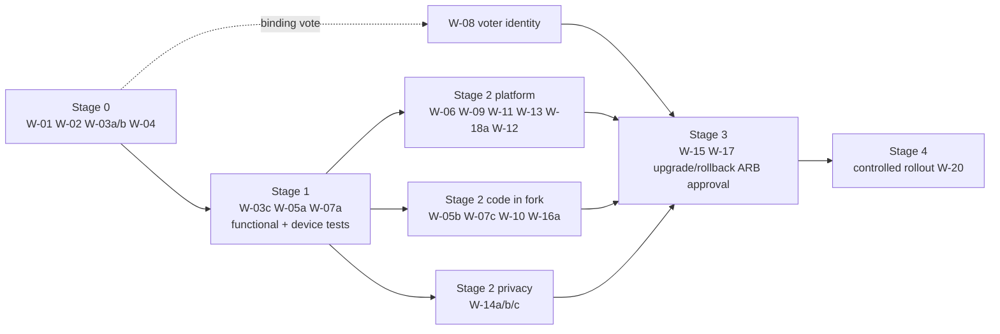

# 04 — Adoption Roadmap

**Subject:** Event Manager (`robword/s48`) at revision `4e33d1c`
**Audience:** Technology leadership, implementation teams, program management, service owners
**Recommended disposition:** **PILOT / PROOF OF CONCEPT** (see [01 — Executive Readout](01-executive-readout.md))
**Risk references:** `R-nn` → [03 — Risk Register](03-risk-register.md) · `EV-nn` / `U-nn` → [05 — Appendix](05-evidence-and-validation-appendix.md)

## Read this first: what kind of adoption this roadmap describes

This software is a small, dependency-free PHP application for running **one in-person pitch event at a time**: timer, slides, phone voting, team formation and a "meet the organizers" loop. It is not a platform and has no multi-event, multi-tenant or HA design. The roadmap therefore aims at a realistic end state:

> **Target state:** an internally owned fork, deployed per event (or per event season) on a hardened single host behind a reverse proxy, used for advisory audience voting and team formation at internal or community events, with documented runbooks, backups during the event, and a manual fallback.

It does **not** lead to a business-critical, always-on, highly available enterprise service. If that is the requirement, stop after Stage 0 and evaluate alternatives (see Exit criteria).

No timelines, staffing commitments or budgets are given; effort is relative (Small / Medium / Large / Unknown). **E** = essential for the stated target; **O** = optional enhancement.

## Work items and risk traceability

| Work item | Title | Addresses | Stage | Essential? |
|---|---|---|---|---|
| W-01 | Qualified legal review (license, branding, AI-authored code) | R-12, U-08 | 0 | E |
| W-02 | Confirm use case, vote criticality, privacy screening, go/no-go criteria | R-01, R-08, U-04, U-12 | 0 | E |
| W-03 | Hosting decision and hardened baseline install | R-07, R-10, R-15, R-20, U-01, U-02, U-07 | 0–1 | E |
| W-04 | Internal fork, named owner, reviewed baseline commit | R-04 | 0 | E (before production) |
| W-05 | Security and compatibility validation (SAST, sink review, supported PHP, vendored library, secret scan) | R-06, R-09, R-15, R-19, U-01, U-09 | 1–2 | E |
| W-06 | SSO + MFA reverse proxy for operator paths | R-03 | 2 | E (where policy requires SSO) |
| W-07 | Rebrand; replace reserved content; per-event operator password | R-12, R-20, R-03 | 1–2 | E |
| W-08 | Voter identity hardening (participant codes or SSO-bound voting) | R-01 | 2 | E only if votes are binding |
| W-09 | Rate limiting / WAF on public write endpoints | R-02 | 2 | E for internet-reachable deployments |
| W-10 | Per-round file cap and dedicated, monitored data volume | R-02 | 2 | E |
| W-11 | Event-time backups of `data_dir`; snapshot before import/reset | R-05, R-18 | 2 | E |
| W-12 | Deployment pipeline controls and protected-path verification | R-07, R-22, U-06 | 2 | E |
| W-13 | Access logging to SIEM and synthetic monitoring | R-14, R-03 | 2 | E |
| W-14 | Privacy notice, retention/purge procedure, accessibility review | R-08, R-17, R-21, U-10, U-12 | 2 | E (where privacy law applies) |
| W-15 | Load and concurrency test at 2× expected audience | R-06, R-13, U-03 | 3 | E |
| W-16 | Ballot/pick integrity fixes and anomaly review | R-16, R-01 | 2–3 | O (E if binding) |
| W-17 | Event runbook, restore drill and full dress rehearsal | R-05, R-14 | 3 | E |
| W-18 | HSTS now; CSP after inline-script review | R-09 | 2–3 | E (HSTS) / O (CSP) |
| W-19 | Results export (CSV) for record-keeping | R-11 | 3 | O |
| W-20 | Lifecycle: patch cadence, upstream review, reassessment, exit plan | R-04, R-15, R-19 | 4 | E |

---

## Stage 0 — Validate suitability

**Goal:** decide whether this tool fits a real need at an acceptable risk level, before anyone installs it.

| Workstream | Activity | Priority | Relative effort | Dependencies | Owner role | Acceptance criteria |
|---|---|---|---|---|---|---|
| Business | **W-02a** Document the event use case: audience size, frequency, who operates it, whether participants use personal phones on the public internet | E | Small | — | Business sponsor | Written use-case statement agreed by sponsor and architect |
| Business / risk | **W-02b** Decide whether the audience vote is **advisory** or **binding** (U-04). If binding, W-08 becomes essential | E | Small | W-02a | Business sponsor; risk owner | Recorded decision; R-01 either accepted (advisory) or scheduled for remediation |
| Privacy | **W-02c** Privacy screening: which personal data will be entered (headshots, names, employers, participant first names), legal basis, retention expectation (U-12) | E | Small | W-02a | Privacy officer | Screening record; DPIA required yes/no |
| Legal | **W-01** Review MIT license, NOTICE exclusions (Startup 48 brand, judging form, deck content), font licences, AI-authorship question (U-08) | E | Small–Medium | — | Legal counsel | Written guidance: permitted use, required rebranding, redistribution limits |
| Architecture | **W-03a** Choose hosting: (a) dedicated small VM/container behind an enterprise reverse proxy (recommended), (b) managed shared hosting, (c) venue-local server. Confirm Apache or an equivalent rule set for non-Apache servers (R-07) | E | Small | W-02a | Solution architect; platform engineer | Hosting decision recorded with the reason; reverse-proxy availability confirmed |
| Security | **W-03b** Confirm a currently supported PHP version will be used (R-15, U-01) | E | Small | W-03a | Platform engineer | Target PHP version named |
| Governance | **W-04** Decide on internal ownership: fork location, accountable owner, reviewed baseline commit (`4e33d1c` or later) | E (before production) | Small | — | Architecture owner; engineering manager | Owner named; fork created |
| Governance | **Go/no-go criteria** defined (see below) | E | Small | All above | ARB | Criteria recorded in the ARB decision record |

**Stage 0 go/no-go criteria (proposed):**
- Use case is a time-boxed event tool, not an always-on or HA service.
- Vote is advisory **or** the sponsor funds W-08.
- Legal review raises no blocker for internal use after rebranding.
- A host with a reverse proxy (or WAF) is available if the voting page will be internet-reachable.
- An internal owner is named.

**Exit (stop) criteria:** HA or multi-site requirements; binding votes with no funding for W-08; regulated data beyond names and headshots; policy prohibiting AI-generated code without review; no available owner.

---

## Stage 1 — Proof of concept

**Goal:** prove the software installs, runs and serves one representative event flow in a controlled environment.

| Workstream | Activity | Priority | Relative effort | Dependencies | Owner role | Acceptance criteria |
|---|---|---|---|---|---|---|
| Platform | **W-03c** Install on a non-production host from the README: `data_dir` outside the web root, `public_base_url` set, operator password via interactive prompt (R-07, R-10, R-20) | E | Small | W-03a, W-03b | Platform engineer | Install log; `config.php` reviewed; protected paths return 403/404 (U-02) |
| Platform | **W-05a** Run on the chosen supported PHP version with `E_ALL` and error logging; exercise every page and API action | E | Small–Medium | W-03c | Platform engineer | No PHP warnings/deprecations in logs across the full flow |
| Functional | Run the full night end to end: add pitches → start/close voting → advance ideas → Explore/Choose/Finalize/Set → roster CSV; showcase loop; timer presets; judging form print | E | Small | W-03c | Event operations lead | Each step completes; observed behaviour matches README |
| Functional | Test with representative devices: iOS and Android phones on cellular data, venue Wi-Fi, projector laptop browsers | E | Small | W-03c | QA engineer | Voting and team-pick flows succeed on each device class |
| Security | Test authentication: wrong-password throttling, CSRF rejection, session expiry on logout, operator API returns 401 without session | E | Small | W-03c | Security engineer | All negative tests behave as designed (EV-06) |
| Integration | Validate the only integration interfaces: roster CSV opens correctly in the organization's spreadsheet tool (formula guard, UTF-8); event-file export/import round trip | E | Small | W-03c | Solution architect | Round trip restores people, headshots and pitches |
| Usability | Operator walkthrough with the people who will run events; collect customization needs (branding, slide content, schedule, judging criteria) | E | Small | Functional test | Event operations lead | Customization backlog recorded |
| Branding | **W-07a** Identify every Startup 48 reference to replace (`NOTICE.md`, `inc/showcase.php:L27`, slides, judging form, logo SVGs, theme tokens, file-format names) | E | Small | W-01 | Application owner | Inventory of items to replace |

**PoC exit:** go/no-go to hardening, with the customization backlog sized.

---

## Stage 2 — Enterprise hardening

**Goal:** close the gaps that matter for the chosen scenario. Most of these are compensating controls outside the application, which keeps the internal fork close to upstream.

| Workstream | Activity | Priority | Relative effort | Dependencies | Owner role | Acceptance criteria |
|---|---|---|---|---|---|---|
| Identity | **W-06** Reverse proxy enforcing SSO (OIDC/SAML) + MFA + group membership on operator paths: `admin/`, `api/admin.php`, `api/showcase-admin.php`, `api/event.php`, `api/rosters.php`. Leave public paths open (R-03) | E where policy requires SSO | Medium | W-03a (proxy exists) | IAM engineer | Operator paths redirect to IdP; public paths work anonymously; proxy logs show named users |
| Identity | **W-07b** Long random operator password, rotated per event, shared only with named operators (R-03, R-20) | E | Small | W-03c | Application owner | Rotation recorded in the event runbook |
| Voter integrity | **W-08** If votes are binding: participant codes (one-time, printed) or SSO-bound voter identity, replacing the cookie as the ballot key (R-01). The ballot API already keys on one identity, which contains the change | E if binding; else O | Medium | W-02b, W-04 | Application owner | Ballot without a valid code is rejected; one ballot per code |
| Abuse protection | **W-09** Per-IP rate limits on `vote/`, `api/ballot.php`, `api/pick.php` at the proxy/WAF; strip client `X-Forwarded-Proto` (R-02, R-10) | E (internet-reachable) | Small–Medium | W-03a | Platform engineer; security engineer | Flood from one source is throttled; legitimate voters unaffected |
| Abuse protection | **W-10** Code change in the fork: cap marker/ballot/pick files per round; put `data_dir` on its own volume with free-space alerting (R-02) | E | Small | W-04 | Application owner; platform engineer | Cap enforced in test; alert fires at threshold |
| Recovery | **W-11** Copy `data_dir` to separate storage every few minutes during events and before any Reset or event-file import (R-05, R-18) | E | Small | W-03c | Platform engineer | Backups present and timestamped during rehearsal |
| Deployment | **W-12** If reusing the GitHub deploy workflow: branch protection with required review on the fork's main branch, environment reviewers, secrets scoped to the environment, protected-path checks kept (R-22, U-06). Otherwise, an equivalent documented deployment | E | Small | W-04 | DevOps lead | Settings evidence; a deploy from an unprotected branch is refused |
| Observability | **W-13** Ship web-server/proxy access and error logs to the SIEM; synthetic check of `api/status.php` and `version.json`; disk-usage alert (R-14) | E | Small–Medium | W-03a | SecOps; platform engineer | Logs visible in SIEM; synthetic check alerts on failure |
| Privacy | **W-14a** Add a short privacy notice to the voting/team-pick page; decide whether the Wi-Fi password belongs in the public showcase API; document who may export the event file (R-08, R-21) | E where privacy law applies | Small | W-02c | Privacy officer; application owner | Notice visible; decision recorded |
| Privacy | **W-14b** Retention/purge procedure: delete old `rounds/*`, unused photos and exported event files after a defined period (old rounds are never deleted by the app, EV-37) | E where privacy law applies | Small | W-02c | Application owner | Procedure documented and executed after the pilot event |
| Accessibility | **W-14c** WCAG 2.x review of `vote/` (ballot and team pick) and the judging form (R-17, U-10) | E where required by policy | Small–Medium | Stage 1 | Accessibility specialist | Findings remediated or accepted |
| Security validation | **W-05b** SAST and manual review of every `innerHTML` sink and all PHP endpoints; secret scanning of full history; verify vendored `qrcode.js` against upstream and record version/checksum (R-06, R-09, R-19, U-09) | E | Medium | W-04 | Security engineer | No unresolved High findings; library provenance recorded |
| Hardening | **W-18a** HSTS at the proxy; `Options -Indexes` and header rules confirmed (R-09) | E | Small | W-03a | Platform engineer | Headers observed in responses |
| Integrity | **W-16a** Optional fork change: take the state lock (shared) when writing ballots/picks so nothing lands after close; log operator pick moves (R-16) | O (E if binding) | Small | W-04 | Application owner | Test: ballot after close is rejected |
| Branding | **W-07c** Replace Startup 48 branding, judging form, deck text and default header with the organization's content (R-12) | E | Small–Medium | W-01, W-07a | Application owner | No reserved Startup 48 assets remain (grep check) |
| Legal | Close out W-01 conditions | E | Small | W-01 | Legal counsel | Sign-off |

**Parallelism:** W-06, W-09, W-11, W-13 and W-18a (platform/proxy) can run in parallel with W-05b, W-07c, W-10 and W-16a (code in the fork) and W-14 (privacy). W-08 waits on the W-02b decision.

---

## Stage 3 — Production readiness

| Workstream | Activity | Priority | Relative effort | Dependencies | Owner role | Acceptance criteria |
|---|---|---|---|---|---|---|
| Performance | **W-15** Load/concurrency test on the production-equivalent host: everyone votes within ~60 s at 2× the expected audience, plus console/slides polling; repeat for team picks (R-06, R-13, U-03) | E | Medium | Stage 2 platform work | Performance/QA engineer | Every submitted ballot present on disk and counted; response times acceptable to the event lead; no write errors |
| Abuse | Repeat the flood test with WAF/rate limits in place (R-02) | E | Small | W-09, W-10 | Security engineer | Throttling works; disk stays bounded |
| Recovery | **W-17a** Restore drill: restore a mid-vote snapshot to a clean host and compare tally and rosters (R-05) | E | Small | W-11 | Platform engineer | Identical results after restore |
| Operations | **W-17b** Event runbook: pre-event checklist (password rotation, `public_base_url`, protected-path check, backup job on, disk headroom), during-event monitoring, manual fallback (show of hands / paper), post-event purge | E | Small | Stages 1–2 | Event operations lead | Runbook approved; used in rehearsal |
| Operations | **W-17c** Full dress rehearsal with operators, phones on cellular data and the projector, including a simulated host failure | E | Small | W-17b | Event operations lead | Rehearsal completed; issues closed |
| Upgrade | Verify upgrade/rollback: deploy a newer fork commit and roll back, confirming `data/` is untouched (deploy excludes it, EV-28) | E | Small | W-12 | DevOps lead | Rollback restores previous version with data intact |
| Records | **W-19** Optional: results CSV export for record-keeping (R-11) | O | Small | W-04 | Application owner | Export matches console ranking |
| Hardening | **W-18b** Optional: CSP using hashes/nonces for inline scripts | O | Medium | W-05b | Security engineer | CSP enforced without console errors |
| Ownership | Assign support roles (see doc 02 §12) | E | Small | W-04 | Service owner | RACI published |
| Governance | ARB and security approval; formal acceptance of residual risks (R-01 if advisory, R-03 residual, R-13, R-16) | E | Small | All above | ARB; risk owner | Signed decision record |
| Release | Release management for the fork: tag each event build; record the deployed SHA (`version.json`) | E | Small | W-12 | Application owner | Tag and SHA recorded per event |

---

## Stage 4 — Production adoption and lifecycle management

| Workstream | Activity | Priority | Relative effort | Dependencies | Owner role | Acceptance criteria |
|---|---|---|---|---|---|---|
| Rollout | Controlled rollout: one internal event, then expand to further events only after a post-event review | E | Small | Stage 3 | Service owner | Post-event review completed with no unresolved High issues |
| Monitoring | Watch during each event: synthetic check, disk usage, submission count vs. attendance (R-01, R-02, R-14) | E | Small (per event) | W-13 | Event operations lead | Monitoring record per event |
| Patching | **W-20a** Patch cadence: supported PHP minor/patch updates on the host; quarterly review of the fork; respond to security reports | E | Small (recurring) | W-04 | Application owner; platform engineer | Patch log kept |
| Upstream | **W-20b** Review upstream changes before merging into the fork; track upstream health (U-11) | E | Small (recurring) | W-04 | Application owner | Review notes per merge |
| Debt | Keep fork changes small and documented (W-08, W-10, W-16, W-19) to ease upstream merges | E | Small | — | Application owner | Fork diff documented |
| Privacy | Execute retention/purge after each event (W-14b) | E | Small (per event) | W-14b | Application owner | Purge record |
| Reassessment | Re-run this assessment annually or on major change (new use case, binding votes, internet exposure change, new personal data) | E | Small–Medium | — | Enterprise architect | Updated assessment |
| Exit | **W-20c** Maintain an exit plan: event-file export and roster CSV are the portable data; alternatives are commercial audience-response/polling or hackathon-management platforms, or an existing enterprise survey tool for the vote alone | E | Small | — | Architecture owner | Exit plan documented; data export verified |

---

## Sequencing summary

**Critical path:** W-02b (advisory vs. binding) → hosting/proxy decision (W-03a) → W-09 + W-11 → W-15 + W-17 → ARB approval. If the vote is binding, W-08 joins the critical path and is the largest single code change.
